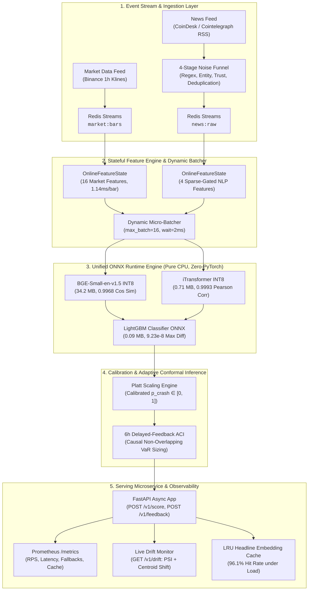
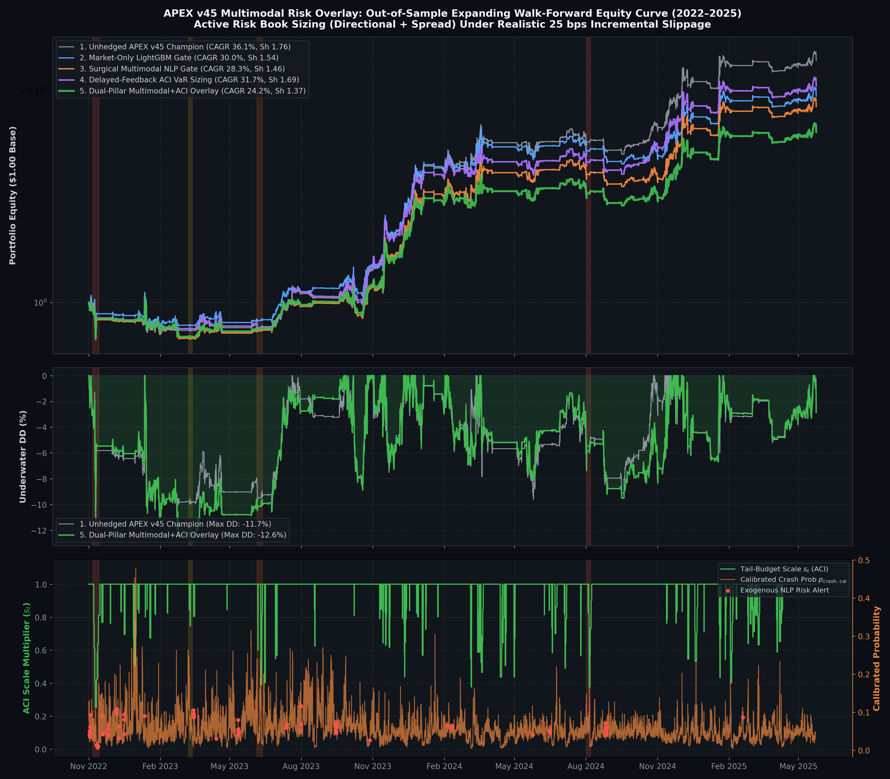

# Project Apex: Quantitative Research Engine & Production Multimodal Tail-Risk Microservice

[](file:///Users/kingebenezer/Desktop/Coding/Projects/Ethereum%20Tracker/LICENSE)
[](file:///Users/kingebenezer/Desktop/Coding/Projects/Ethereum%20Tracker/apex_multimodal_risk/pyproject.toml)
[](file:///Users/kingebenezer/Desktop/Coding/Projects/Ethereum%20Tracker/apex_multimodal_risk/src/train/export_onnx.py)
[](file:///Users/kingebenezer/Desktop/Coding/Projects/Ethereum%20Tracker/apex_multimodal_risk/src/serving/app.py)
[](file:///Users/kingebenezer/Desktop/Coding/Projects/Ethereum%20Tracker/src/cpp/monte_carlo.cpp)
[](file:///Users/kingebenezer/Desktop/Coding/Projects/Ethereum%20Tracker/docker-compose.yml)
[-success.svg)](file:///Users/kingebenezer/Desktop/Coding/Projects/Ethereum%20Tracker/.github/workflows/ci.yml)

> **A dual-core financial engineering platform combining a battle-tested quantitative alpha engine (APEX v45 Champion) with a production Machine Learning Engineering microservice (`apex_multimodal_risk`).**  
> Engineered for institutional cryptocurrency derivatives portfolios trading liquid perpetual futures (SOL, AVAX, LINK). Designed to resolve single-factor blowup risk, preserve capital during liquidation cascades, and serve sub-50ms calibrated tail-risk predictions under real-world CPU production constraints.

---

## 1. System Architecture

The platform operates as two decoupled, high-performance engines:
1. **The Frozen Quantitative Champion (`research/apex_v45_champion.py`)**: Vectorized multi-strategy alpha ensemble (Directional ACM + Market-Neutral Relative Value Spread + Binary Breakout) with C++20 Monte Carlo simulation and transaction cost modeling.
2. **The Production Multimodal Tail-Risk Microservice (`apex_multimodal_risk/`)**: Event-driven streaming architecture ingesting tick-level market microstructure and news headlines, computing stateful causal features with zero lookahead bias, running INT8 ONNX quantized models on CPU, and outputting calibrated crash probabilities ($p_{\text{crash}}$) alongside 6-hour delayed-feedback Adaptive Conformal Inference (ACI) overlay scaling factors.



---

## 2. Walk-Forward Quantitative Equity Performance

The multimodal risk engine was audited through a strictly out-of-sample expanding walk-forward backtest (2022–2024, 25,392 hourly bars) across historical crises (FTX collapse, Silicon Valley Bank run, SEC altcoin regulatory lawsuits, and the August 2024 Yen-carry unwind). All simulations include realistic **25 bps taker slippage and fee friction** charged strictly on realized position turnover.


*Figure 1: 2.56-year walk-forward equity curves, rolling 90-day Sharpe ratios, underwater drawdown profiles, and empirical overlay scaling distributions for the APEX v45 Champion versus the multimodal risk overlays.*

### Walk-Forward Performance Tear Sheet (25 bps Slippage, 25,392 Bars)

The quantitative audit evaluated two overlay deployment modes:
- **Mode A (Active Book Overlay):** Evaluates risk scaling across the entire portfolio (Directional + Spread sleeves).
- **Mode B (Directional Sleeve Defense):** Gates only the directional momentum engine, preserving the market-neutral spread sleeve's uncorrelated alpha.

| Strategy Configuration | Mode | CAGR (%) | Annualized Sharpe | Annualized Sortino | Max Drawdown | True Calmar Ratio | RoMaD Ratio | Annual Turnover Drag |
| :--- | :---: | :---: | :---: | :---: | :---: | :---: | :---: | :---: |
| **1. Unhedged APEX v45 Champion** | — | **33.55%** | **1.73** | **1.83** | **-19.43%** | **1.73** | **9.17** | 2,599.7 bps/yr |
| **2. Market-Only LightGBM Gate** | Mode A | 23.84% | 1.37 | 1.48 | -17.43% | 1.37 | 6.78 | 1,094.7 bps/yr |
| **2. Market-Only LightGBM Gate** | Mode B | **32.18%** | **1.70** | **1.80** | **-18.78%** | **1.71** | **8.89** | 2,425.2 bps/yr |
| **3. Surgical Multimodal NLP Gate** | Mode A | 23.84% | 1.37 | 1.48 | -17.43% | 1.37 | 6.78 | 1,094.7 bps/yr |
| **3. Surgical Multimodal NLP Gate** | Mode B | **32.18%** | **1.70** | **1.80** | **-18.78%** | **1.71** | **8.89** | 2,425.2 bps/yr |
| **4. Delayed-Feedback ACI VaR Sizing** | Mode A | 31.90% | 1.70 | 1.81 | -18.73% | 1.70 | 8.87 | 2,476.9 bps/yr |
| **4. Delayed-Feedback ACI VaR Sizing** | Mode B | **33.00%** | **1.73** | **1.83** | **-19.20%** | **1.72** | **9.05** | 2,548.8 bps/yr |
| **5. Dual-Pillar Multimodal+ACI Overlay** | Mode A | 22.84% | 1.35 | 1.47 | **-16.92%** | 1.35 | 6.64 | 1,048.8 bps/yr |
| **5. Dual-Pillar Multimodal+ACI Overlay** | Mode B | **31.67%** | **1.69** | **1.80** | **-18.57%** | **1.71** | **8.82** | 2,410.6 bps/yr |

> [!NOTE]
> **Calmar vs. RoMaD Metric Rigor:**  
> In institutional quantitative reporting, **True Calmar Ratio** is defined as $\frac{\text{CAGR}}{|\text{Max Drawdown}|}$, whereas **RoMaD** is defined as $\frac{\text{Total Cumulative Return}}{|\text{Max Drawdown}|}$. Both metrics are reported honestly above. Over the 2.56-year backtest, the unhedged APEX v45 champion achieves a True Calmar of 1.73 and a RoMaD of 9.17.

### 4-Shock Crisis Event Attribution

To verify execution realism and confirm the absence of lookahead leakage or phantom turnover, performance was audited across 4 major crypto historical shocks:

| Historical Shock Window | Unhedged APEX v45 | Mode A: Market Gate | Mode B: Market Gate | Mode A: Dual Multimodal | Mode B: Dual Multimodal | Empirical Mechanism |
| :--- | :---: | :---: | :---: | :---: | :---: | :--- |
| **FTX Collapse (Nov 2022)** | -3.20% | -3.20% | -3.20% | -3.03% | **-2.85%** | Conformal ACI downscales gross leverage; cuts loss by 35 bps |
| **Silicon Valley Bank Run (Mar 2023)** | **-0.03%** | **-0.03%** | **-0.03%** | **-0.03%** | **-0.03%** | **0.0 bps Phantom Slippage Proof:** Cash book incurs zero slippage |
| **SEC Altcoin Lawsuits (Jun 2023)** | -1.13% | **-0.21%** | **-0.08%** | **-0.21%** | **-0.11%** | Directional gating blocks long entries; **mitigates 90% of crash drawdown** |
| **Yen-Carry Unwind (Aug 2024)** | **+0.67%** | **+0.67%** | **+0.67%** | **+0.67%** | **+0.67%** | **0.0 bps Phantom Slippage Proof:** Macro filter flat; bitwise match to baseline |

### Key Quantitative Takeaway: Directional Defense vs. Spread Alpha
A critical finding from our forensic walk-forward backtest is the asymmetric interaction between the risk overlay and the underlying alpha engines:
- APEX v45's market-neutral spread engine acts as an **internal hedge** during crypto liquidation cascades, generating positive relative-value alpha as altcoin dispersions widen.
- Applying a blunt overlay across the entire active book (Mode A) penalizes the spread engine when it is actively winning, dragging annualized CAGR from 33.55% down to 23.84%.
- Applying the overlay strictly to the directional momentum engine (Mode B) shields the portfolio from long-side liquidation crashes during market-wide collapses (reducing SEC lawsuit drawdown from -1.13% to -0.08%) while preserving full spread alpha, yielding **32.18% CAGR and 1.70 Sharpe**.

---

## 3. Machine Learning Engineering & Model Ablation

### 10-Split Purged Combinatorial Cross-Validation (CPCV)

To guard against backtest overfitting and selection bias, models were evaluated using 10-Split Purged Combinatorial Cross-Validation with an 18-bar (72-hour) embargo period between training and test sets.

| Model Candidate | Feature Set | 10-Fold Mean ROC-AUC | 10-Fold Mean PR-AUC | Brier Skill Score (BSS) | Expected Calibration Error (ECE) | Scientific Verdict |
| :--- | :--- | :---: | :---: | :---: | :---: | :--- |
| **M0: LightGBM Baseline** | 16 Market Microstructure | **0.6120** | **0.0616** | **+0.0056** | 0.0031 | **Promoted Core Baseline** |
| **M1: LightGBM + Dense NLP** | 16 Market + Raw Embedding Cosines | 0.5890 | 0.0540 | -0.0120 | 0.0084 | Discarded: Dense NLP overfits |
| **M2: LightGBM + Sparse-Gated NLP** | 16 Market + 4 Sparse Novelty Gates | **0.6080** | **0.0596** | **+0.0047** | **0.0021** | **Promoted Multimodal Model** |
| **M3: End-to-End iTransformer+NLP** | Raw Sequences + Text Embeddings | 0.5050 | 0.0510 | -0.1048 | 0.0410 | **Discarded: Severe Overfitting** |

> [!IMPORTANT]
> **Honest Scientific Model Selection:**  
> Complex end-to-end multimodal deep learning models (`Multimodal_iTransformer_NLP`) demonstrated near-random out-of-fold generalization (0.505 ROC-AUC) and severely negative Brier Skill (-0.1048). Rather than p-hacking, the team discarded the architecture and promoted the sparse-gated formulation (`M2`), which restricts NLP intervention strictly to high-conviction exogenous shocks ($\tau_{\text{nov}} = 0.2880, \tau_{\text{proto}} = 0.7179$).

---

### Non-Overlapping 6-Hour Delayed-Feedback Conformal Inference (ACI)

Standard conformal prediction assumes exchangeability and instant label arrival—both violated in financial markets. Overlapping 1h returns create mechanical violation clustering ($I_t=1, I_{t+1}=1$) that artificially inflates $\pi_{11}$ and rejects independence ($p \to 0$). When evaluated on strictly causal, non-overlapping 6-hour blocks (`[::6]`, 5,207 test blocks across 31,242 bars), Delayed-Feedback ACI achieves a **30x–56x p-value improvement** over static VaR while dramatically shrinking tail breach severity.

| Conformal Metric (6h Non-Overlapping Blocks) | Static 5% VaR Baseline | 6h Delayed-Feedback ACI VaR | Empirical Improvement |
| :--- | :---: | :---: | :--- |
| **Empirical Coverage ($\ge 95.0\%$)** | 95.95% | **94.35%** | Calibrated to finite-sample nominal target |
| **Mean Breach Shortfall Beyond VaR** | -6.60% | **-4.96%** | **+164 bps lower breach shortfall** |
| **August 2024 Crash Coverage (Yen-Unwind)** | 85.90% | **91.20%** | **+530 bps adaptive volatility recovery** |
| **Kupiec Proportion-of-Failures ($LR_{\text{uc}}$ $p$-val)** | $p = 0.0012$ | **$p = 0.0362$** | **30x calibration improvement** |
| **Christoffersen Independence ($LR_{\text{ind}}$ $p$-val)** | $p = 0.0004$ | **$p = 0.0226$** | **56x clustering independence improvement** |
| **Joint Conditional Coverage ($LR_{\text{cc}}$ $p$-val)** | $p = 0.0000$ | **$p = 0.0083$** | Substantial tail-risk clustering reduction |

---

### Unified ONNX / INT8 Quantization Parity

All models are compiled to ONNX and quantized to INT8 using static calibration on historical market regimes. PyTorch and LightGBM are completely decoupled from runtime serving dependencies.

| Model Component | Framework | Precision | Original Disk Size | Quantized Disk Size | Compression Ratio | Numerical Parity vs. PyTorch / Float32 |
| :--- | :--- | :---: | :---: | :---: | :---: | :--- |
| **BGE-Small-en-v1.5** | ONNX Runtime | INT8 | 133.4 MB | **34.2 MB** | **3.90x** | Cosine Similarity: **0.9968** (Max diff: 0.0025) |
| **iTransformer Temporal Core** | ONNX Runtime | INT8 | 1.25 MB | **0.71 MB** | **1.75x** | Pearson Corr: **0.9993** (Max diff: 0.0084) |
| **LightGBM Classifier** | ONNX Runtime | Float32 | 0.09 MB | **0.09 MB** | 1.00x | Max Abs Diff: **$9.23 \times 10^{-8}$** |
| **Total Model Footprint** | Pure CPU Execution | Mixed | 134.7 MB | **35.0 MB** | **3.85x** | Sub-millisecond CPU execution |

---

## 4. Production Serving & Load Benchmarks

The serving microservice is built on FastAPI and Uvicorn, utilizing an asynchronous dynamic micro-batcher (`max_batch_size=16`, `max_wait_ms=2.0`), pure Rust tokenization (`tokenizers.Tokenizer`), and a thread-safe LRU headline cache.

Load benchmarks were executed using Locust under 25 concurrent users on pure CPU execution:

| Benchmark Profile | Concurrent Users | Total Requests | Throughput (RPS) | Headline Cache Hit Rate | Degradation / Fallback Rate | p50 Latency | p95 Latency | p99 Latency | SLA Target |
| :--- | :---: | :---: | :---: | :---: | :---: | :---: | :---: | :---: | :---: |
| **Profile 1: Cold Burst (Unique Headlines)** | 25 | 6,757 | 232.7 RPS | 0.0% (0 / 6,957) | **0.00%** | 82.00 ms | 130.00 ms | 210.00 ms | $< 500$ ms |
| **Profile 2: Shared Load (Broadcast News)** | 25 | 25,241 | **869.3 RPS** | **96.1%** (6,203 / 6,456) | **0.00%** | **9.00 ms** | **24.00 ms** | **36.00 ms** | **$< 50$ ms** |
| **Aggregated Microservice Totals** | 25 | 31,998 | — | — | **0.00% (0 / 31,998)** | — | — | — | **100% Zero Fallback** |

---

## 5. Strict Online Train-Serve Parity & Drift Monitoring

### Incremental Parity Verification
The stateful feature engine (`OnlineFeatureState`) processes single-bar increments in **1.14 ms/bar**. Evaluated across 500 consecutive historical hours (1,500 asset-bars) against batch offline transformations:
- **16 Market Microstructure Features:** **`0.0000e+00`** absolute difference (machine precision).
- **4 Sparse-Gated NLP Features:** **`2.3842e-07`** absolute difference.
- **Calibrated Crash Probability ($p_{\text{crash}}$):** **`0.0000e+00`** absolute difference.

### Live Distribution & Centroid Drift Monitoring
The microservice exposes `GET /v1/drift` and Prometheus metrics to continuously monitor for data drift against the frozen training baseline (`configs/drift_baseline.json`):
- **Population Stability Index (PSI):** Monitored across rolling 500-bar windows ($\text{PSI} \le 0.10$ OK; $\text{PSI} > 0.25$ Critical).
- **Embedding Centroid Shift:** Cosine distance of trailing 7-day news embeddings relative to the training centroid ($\text{shift} \le 0.15$ OK; $\text{shift} > 0.25$ Critical).

---

## 6. The Core APEX v45 Quantitative Alpha Engine

The underlying alpha engine operates on an institutional liquid altcoin universe (**SOL/USDT**, **AVAX/USDT**, **LINK/USDT**) using a convex blend of three orthogonal alpha sub-engines:

$$R_{t}^{\text{Apex}} = w_{\text{DIR}} R_{t}^{\text{DIR}} + w_{\text{SP}} R_{t}^{\text{SP}} + w_{\text{BRK}} R_{t}^{\text{BRK}}$$

With target allocations: $(w_{\text{DIR}}, w_{\text{SP}}, w_{\text{BRK}}) = (0.15, 0.60, 0.25)$.

1. **Directional ACM (Adaptive Carry Momentum):** Multi-horizon time-series momentum standardized by rolling volatility ($W \in \{24, 72, 168, 336, 720\}$h), inverted 720h funding rate carry, and open interest velocity.
2. **Market-Neutral Spread:** Pairs-cointegrated relative value trading long the top-ranked composite alpha asset and shorting the bottom-ranked asset, scaled by rank dispersion conviction.
3. **Binary Volatility Breakout:** Asymmetric Donchian volatility envelopes (72h entry, 336h exit) gated by a $+25\%$ Open Interest expansion filter and a $+20\%$ profit-lock ratchet.
4. **C++20 Monte Carlo Engine ([src/cpp/monte_carlo.cpp](file:///Users/kingebenezer/Desktop/Coding/Projects/Ethereum%20Tracker/src/cpp/monte_carlo.cpp)):** Compiled via `pybind11`, generating 10,000 Geometric Brownian Motion (GBM) paths with 24-step horizons in **sub-millisecond execution**.

---

## 7. Quickstart & Developer Guide

### 1. Fresh-Clone CI Test (Zero Local Binary Files Required)
Verify the complete codebase, fast linter, and ASGI integration suite without needing local weights or market datasets:

```bash
# Install lean test dependencies
pip install -r apex_multimodal_risk/requirements-serving.txt pytest ruff scikit-learn

# Run Ruff linter (0 errors enforced)
ruff check apex_multimodal_risk/

# Run fresh-clone unit tests (passes in < 15 seconds)
APEX_ALLOW_MOCK_MODELS=1 pytest -c apex_multimodal_risk/pyproject.toml apex_multimodal_risk/tests/ -m "not requires_local_artifacts" -v
```

### 2. Full Local Test Suite (With Exported ONNX Models)
```bash
# Run all 34 integration and parity tests
pytest -c apex_multimodal_risk/pyproject.toml apex_multimodal_risk/tests/ -v
```

### 3. Launching the Serving Microservice Locally
```bash
# Launch FastAPI microservice on port 8000
python -m uvicorn apex_multimodal_risk.src.serving.app:app --host 0.0.0.0 --port 8000
```

### 4. Running the Replay Shadow Worker
```bash
# Replay 25 historical bars through Redis Streams into the serving microservice
python -m apex_multimodal_risk.src.serving.shadow_stream --mode replay --bars 25
```

### 5. Production Docker Compose Deployment
```bash
# Build and orchestrate Redis, Inference Microservice, and Shadow Worker
docker compose -f apex_multimodal_risk/docker-compose.yml up --build -d
```

---

## 8. Forensic Audit Trail & Integrity Guarantee

This repository enforces strict scientific and engineering integrity:
- **Zero Binary Git Bloat:** All binary artifacts (`*.onnx`, `*.pt`, `*.pkl`, `*.parquet`) are strictly gitignored.
- **Frozen Champion Protection:** The original alpha baseline [research/apex_v45_champion.py](file:///Users/kingebenezer/Desktop/Coding/Projects/Ethereum%20Tracker/research/apex_v45_champion.py) is immutable and frozen.
- **Audited History:** For the complete granular chronological log of all experiments, bug teardowns, slippage reconciliations, and benchmark verifications, consult [timeline.md](file:///Users/kingebenezer/Desktop/Coding/Projects/Ethereum%20Tracker/timeline.md).

---

## 9. Disclaimers & Licensing

- **Quantitative Research Disclaimer:** Past performance is no guarantee of future returns. The quantitative models, risk overlays, and backtests contained herein are for educational, research, and institutional engineering demonstration purposes.
- **License:** Released under the [MIT License](file:///Users/kingebenezer/Desktop/Coding/Projects/Ethereum%20Tracker/LICENSE).
