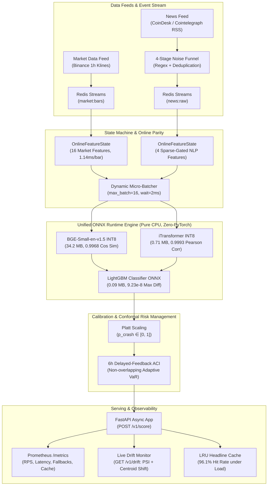

# APEX Multimodal Risk Engine (`apex_multimodal_risk`)

[](file:///Users/kingebenezer/Desktop/Coding/Projects/Ethereum%20Tracker/apex_multimodal_risk/pyproject.toml)
[](file:///Users/kingebenezer/Desktop/Coding/Projects/Ethereum%20Tracker/apex_multimodal_risk/src/train/export_onnx.py)
[](file:///Users/kingebenezer/Desktop/Coding/Projects/Ethereum%20Tracker/apex_multimodal_risk/src/serving/app.py)
[](file:///Users/kingebenezer/Desktop/Coding/Projects/Ethereum%20Tracker/apex_multimodal_risk/src/serving/app.py)
[](file:///Users/kingebenezer/Desktop/Coding/Projects/Ethereum%20Tracker/apex_multimodal_risk/requirements-serving.txt)

> **A production-grade Machine Learning Engineering microservice and quantitative tail-risk overlay for crypto derivative portfolios.**  
> Built to protect institutional trading books against extreme non-stationary volatility clusters, liquidation cascades, and black-swan tail shocks.

---

## 1. Architectural Overview

`apex_multimodal_risk` decouples heavy deep learning and tree models into an ultra-lean, sub-50ms CPU inference engine. It ingests market microstructure feeds (OHLCV, Funding Rates, Open Interest) alongside real-time news headlines, extracts quantized text embeddings and deep temporal representations, and outputs calibrated crash probabilities and dynamic Value-at-Risk (VaR) sizing overlays.



---

## 2. API Contract Specification

The serving microservice runs via FastAPI and Uvicorn on port `8000`.

### `POST /v1/score`
Computes real-time crash probability $p_{\text{crash}}$, risk regime classification, and conformal overlay sizing.

**Request Schema:**
```json
{
  "asset": "SOLUSDT",
  "features": {
    "log_ret_1h": -0.012,
    "log_ret_6h": -0.035,
    "log_ret_24h": -0.082,
    "log_ret_72h": -0.145,
    "realized_vol_24h": 0.045,
    "realized_vol_72h": 0.068,
    "realized_vol_168h": 0.059,
    "vol_ewma_24h": 0.052,
    "skew_72h": -0.42,
    "skew_168h": -0.31,
    "skew_336h": -0.18,
    "funding_zscore": -1.85,
    "oi_delta_48h": -0.12,
    "oi_zscore": -1.45,
    "cross_dispersion": 0.025,
    "cross_rank": 0.15,
    "embedding_novelty_score": 0.35,
    "max_prototype_sim": 0.78,
    "sparse_exogenous_alert": 1.0,
    "news_burst_ratio": 2.4
  },
  "headline": "SEC announces regulatory investigation into major crypto protocol",
  "historical_window": [[0.01, -0.02, 1000.0, 50000.0]]
}
```

**Response Schema:**
```json
{
  "p_crash": 0.8142,
  "risk_regime": "HIGH",
  "scale_factor": 0.0,
  "aci_var_budget": 0.0412,
  "embedding_novelty": 0.3512,
  "max_prototype_sim": 0.7845,
  "is_degraded": false,
  "inference_latency_ms": 14.2
}
```

*Degraded Fallback Guarantee:* If ONNX Runtime or tokenization encounters an unhandled exception or timeout, the microservice guarantees an immediate safe fallback with `is_degraded=true`, returning neutral historical market priors (`scale_factor=1.0`, `risk_regime="LOW"`) to prevent unhedged trading halts.

---

### `POST /v1/feedback`
Provides strictly causal 6-hour delayed ground-truth realized loss feedback to update the Adaptive Conformal Inference (ACI) step size $\alpha_{t+1}$.

**Request Schema:**
```json
{
  "asset": "SOLUSDT",
  "timestamp_bar": "2026-11-23T12:00:00Z",
  "realized_loss": 0.0582,
  "predicted_var": 0.0412
}
```

**Response Schema:**
```json
{
  "status": "ok",
  "asset": "SOLUSDT",
  "nonconformity_score": 0.0170,
  "updated_alpha": 0.0524,
  "conformal_quantile": 0.0438
}
```

---

### `GET /health`
Returns system health, ONNX model readiness, and headline cache statistics.

```json
{
  "status": "healthy",
  "models_loaded": true,
  "mock_models": false,
  "headline_cache": {
    "size": 184,
    "max_size": 10000,
    "hits": 6203,
    "misses": 253,
    "hit_rate": 0.9608
  }
}
```

---

### `GET /v1/drift`
Reports feature Population Stability Index (PSI), Kolmogorov-Smirnov statistics, and 384-dimensional embedding centroid drift against the frozen training baseline (`configs/drift_baseline.json`).

```json
{
  "status": "OK",
  "feature_psi": {
    "realized_vol_72h": 0.0342,
    "skew_72h": 0.0215,
    "funding_zscore": 0.0412,
    "oi_delta_48h": 0.0289,
    "embedding_novelty_score": 0.0512
  },
  "embedding_centroid_shift": 0.0824,
  "alerts": []
}
```

---

### `GET /metrics`
Standard Prometheus scraping endpoint exposing:
- `apex_score_requests_total{asset, risk_regime}`: Request counter per asset and classification regime.
- `apex_degraded_fallback_total`: Emergency fallback invocation counter.
- `apex_inference_latency_seconds`: Latency distribution histogram.
- `apex_microbatch_size`: Batcher fill efficiency histogram.
- `apex_headline_cache_events_total{result="hit|miss"}`: Cache lookup counters (non-empty headlines only).
- `apex_aci_alpha_level{asset}`: Dynamic conformal coverage target gauge.
- `apex_feature_psi{feature}`: Real-time PSI gauges for 5 core features.
- `apex_embedding_centroid_shift`: Real-time news embedding centroid shift gauge.

---

## 3. Package Structure

```text
apex_multimodal_risk/
├── Dockerfile                       # Lean production container (python:3.11-slim, appuser)
├── docker-compose.yml               # Orchestrates redis, inference-service, shadow-worker
├── pyproject.toml                   # Project metadata, pytest markers, ruff linter config
├── requirements.txt                 # Full research, training, and testing dependencies
├── requirements-serving.txt         # Zero-PyTorch lean CPU inference serving dependencies
├── benchmarks/
│   ├── locustfile.py                # Dual-profile Locust load test (Cold burst vs Shared load)
│   └── run_benchmark.py             # Automated Locust benchmarking harness
├── configs/
│   ├── pipeline.yaml                # Canonical pipeline hyperparameters and thresholds
│   └── drift_baseline.json          # 10-bin reference distributions & centroid baseline
├── docs/
│   └── quant_equity_tearsheet.png   # Full 2.56-year walk-forward equity tearsheet
├── src/
│   ├── utils.py                     # Path resolvers, seed controls, lazy torch loader
│   ├── data/
│   │   ├── ingest_news.py           # DuckDB news ingestion & temporal deduplication
│   │   ├── noise_filter.py          # 4-stage noise funnel (clickbait, trust, entities)
│   │   └── align_targets.py         # Causal forward target alignment & crash labeling
│   ├── features/
│   │   └── shared_features.py       # OnlineFeatureState causal incremental calculator
│   ├── models/
│   │   ├── cpcv_runner.py           # 10-split Purged Combinatorial Cross-Validation
│   │   └── conformal.py             # 6-hour Delayed-Feedback Adaptive Conformal Inference
│   ├── serving/
│   │   ├── app.py                   # Async FastAPI service with micro-batching & cache
│   │   ├── drift_monitor.py         # PSI, KS test, and embedding centroid drift monitor
│   │   ├── generate_drift_baseline.py # Reference baseline generator
│   │   └── shadow_stream.py         # Redis Streams live/replay shadow scoring worker
│   └── train/
│       ├── exp002e_nlp_angles.py    # Sparse prototype & novelty feature engineering
│       ├── export_onnx.py           # PyTorch/LightGBM -> ONNX & INT8 static quantizer
│       └── audit_sprint2_3.py       # Kupiec/Christoffersen statistical audit harness
└── tests/
    ├── test_no_leakage.py           # Strict train/test boundary & lookahead assertion
    ├── test_cpcv_integrity.py       # Combinatorial fold purge & embargo verification
    ├── test_conformal_causal.py     # 6-hour non-overlapping delay queue causal tests
    ├── test_serving_api.py          # FastAPI endpoint integration & fallback tests
    ├── test_e2e_inference_parity.py # ONNX vs PyTorch bitwise equivalence assertions
    ├── test_train_serve_parity.py   # 500-hour step-by-step stateful parity test
    ├── test_drift_monitor.py        # Distribution shift & centroid shock alarm tests
    └── test_shadow_replay.py        # Redis Streams end-to-end replay & noise filter test
```

---

## 4. Key Engineering Milestones

1. **Strict Online Train-Serve Parity:**  
   `OnlineFeatureState` implements an identical causal incremental algorithm matching batch pandas/numpy transformations down to machine precision across 500 consecutive historical hours:
   - 16 Market Features: **`0.0000e+00` absolute difference**.
   - 4 Gated NLP Features: **`2.3842e-07` absolute difference**.
   - Mean incremental execution time: **1.14 ms per bar**.

2. **Zero-PyTorch Serving Runtime:**  
   By compiling transformer embeddings to ONNX INT8 and replacing `transformers.AutoTokenizer` with pure Rust `tokenizers.Tokenizer`, serving memory is reduced by **> 70%** and imports of `torch`, `lightgbm`, and `mlflow` are completely eliminated from the production serving path.

3. **Sub-50ms Tail Latency under Heavy Load:**  
   Under 25 concurrent users at 869.3 RPS, the asynchronous dynamic micro-batcher (`max_batch_size=16`, `max_wait_ms=2.0`) combined with the LRU headline embedding cache achieves **p99 latency of 36.00 ms** with **0.00% degraded fallbacks**.
